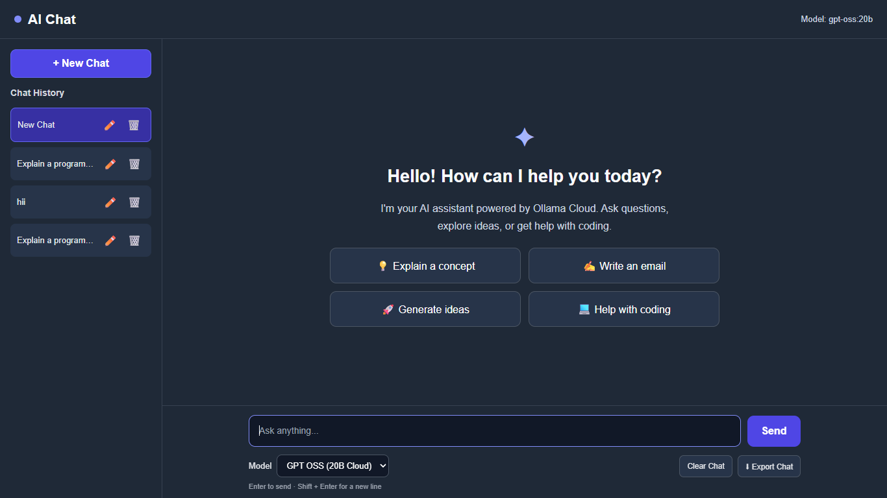
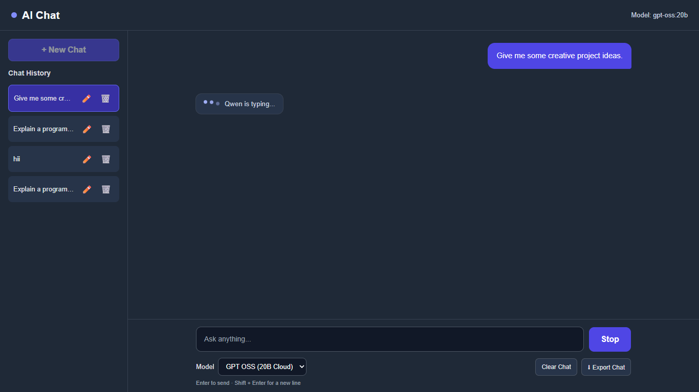
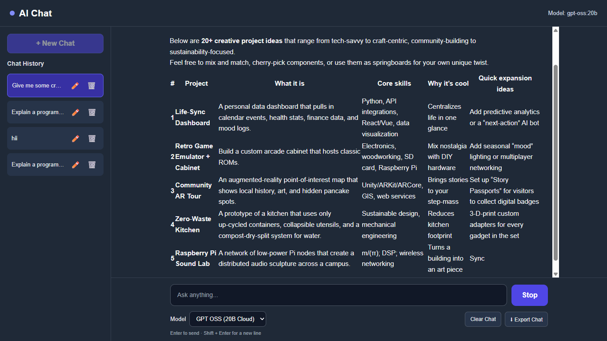

# 🤖 AI Chatbot

An AI-powered chatbot built using **HTML, CSS, JavaScript, Node.js, Express, and Ollama**. It provides AI-generated responses with streaming, chat history, conversation management, and a responsive user interface.

<p align="center">
  <a href="https://chatbot-git-main-kamalitherasa2412-3088s-projects.vercel.app/">
    <strong>🚀 Live Demo</strong>
  </a>
</p>

## 📸 Screenshots

### Home Page


### Chat Interface


### Chat History


> Add your actual screenshots to `assets/screenshots/` using the filenames shown above.

## ✨ Features

- AI-powered conversations using Ollama.
- Streaming AI responses.
- Multiple chat conversations.
- Create new conversations.
- Rename and delete chat history.
- Copy AI responses.
- Copy code snippets.
- Regenerate AI responses.
- Stop response generation.
- Export conversations as text files.
- Markdown response rendering.
- Suggested prompts for quick interaction.
- Responsive design for desktop and mobile.
- Local storage to save chat history.

## 🛠️ Technologies Used

| Technology | Purpose |
|---|---|
| HTML5 | Website structure |
| CSS3 | Styling and responsive design |
| JavaScript | Frontend functionality |
| Node.js | Backend runtime |
| Express.js | Backend API |
| Ollama | AI model integration |
| Vercel | Cloud deployment |
| Git & GitHub | Version control |

## 📂 Project Structure

```text
Chatbot/
│
├── public/
│   ├── index.html
│   ├── styles.css
│   └── main.js
│
├── assets/
│   └── screenshots/
│       ├── home.png
│       ├── chat.png
│       └── history.png
│
├── server.js
├── package.json
├── package-lock.json
├── .gitignore
└── README.md
```

## ⚙️ Installation and Setup

### 1. Clone the repository

```bash
git clone https://github.com/KamalitherasaR/Chatbot.git
```

### 2. Navigate to the project folder

```bash
cd Chatbot
```

### 3. Install dependencies

```bash
npm install
```

### 4. Install Ollama

Install Ollama on your computer and download the local model:

```bash
ollama pull qwen2.5:1.5b
```

### 5. Start the chatbot

Make sure Ollama is running, then execute:

```bash
npm start
```

### 6. Open in your browser

```text
http://localhost:3000
```

## ☁️ Deployment

This project is deployed using **Vercel** and connects to Ollama Cloud for online AI responses.

- Cloud API credentials are configured using Vercel Environment Variables.
- The API key is stored securely on the backend.
- Never expose API keys in frontend code or commit them to GitHub.

## 🔗 Project Links

- **Live Demo:** [Open Chatbot](https://chatbot-git-main-kamalitherasa2412-3088s-projects.vercel.app/)
- **GitHub Repository:** [View Source Code](https://github.com/KamalitherasaR/Chatbot)

## 👩‍💻 Author

**Kamali Therasa R**

- GitHub: [@KamalitherasaR](https://github.com/KamalitherasaR)

---

<p align="center">
  ⭐ If you like this project, consider giving it a star!
</p>


